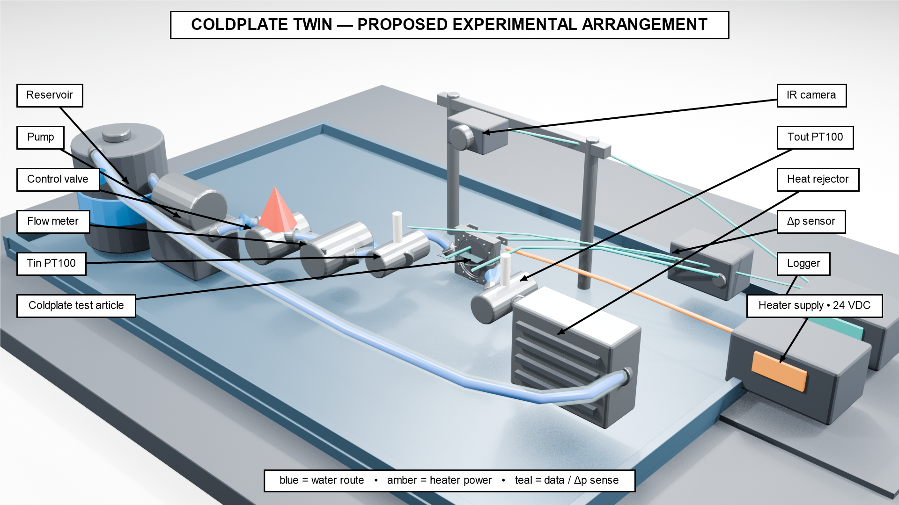
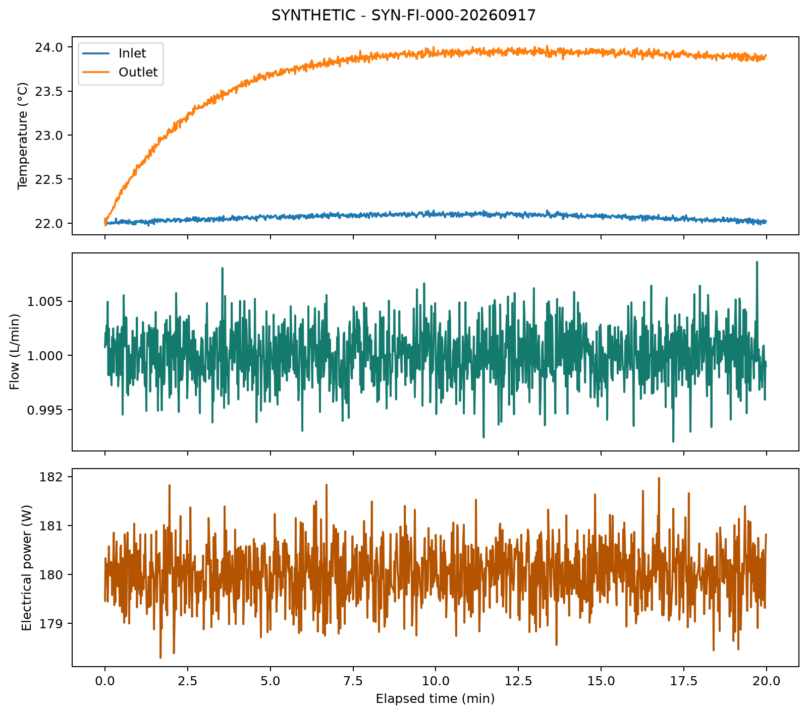
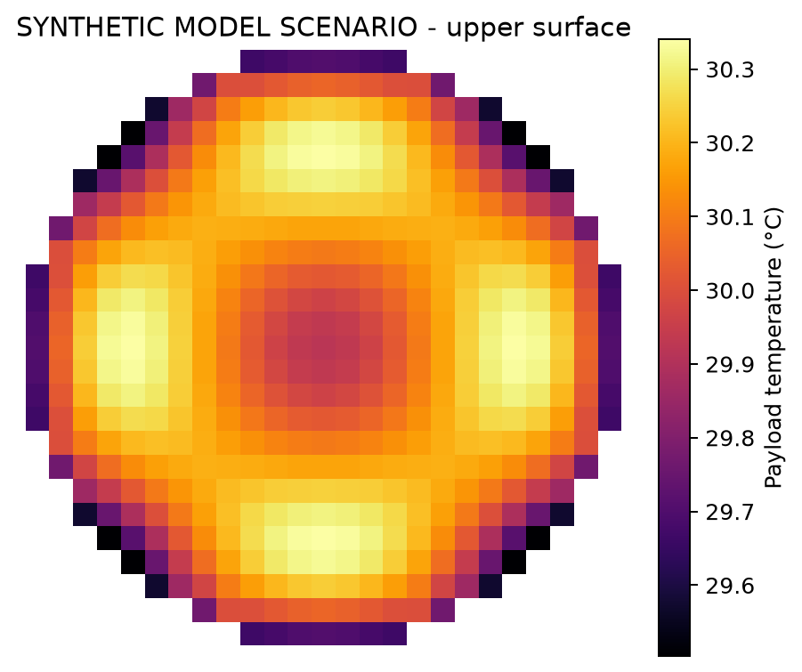

# ColdPlateTwin (Rev A)

I wanted to know how much a flow insert actually changes a water-cooled cold plate: the heat it pulls into the water, the pressure drop it costs and how even the surface temperature gets. ColdPlateTwin is the setup I built to answer that. It has the parametric CAD for a testbed with interchangeable flow inserts, the code that analyzes the experiment, and simple reduced-order thermal-hydraulic models. The analysis takes time-stamped logger data, plus radiometric temperature matrices if you have them, and turns them into calorimetry, stability checks, uncertainty estimates and surface-temperature metrics.



*The proposed setup, rendered in Blender from the Rev A cold-plate CAD. The extra equipment and the layout are schematic and not to scale. This isn't a photo of a built rig or a thermal simulation result.*

[Theory and methods](docs/theory_and_methods.md) · [Experiment protocol](docs/experiment_protocol.md) · [CAD assembly](freecad/ColdPlate_RevA.FCStd) · [Blender scene and render source](visualization/README.md)

Status: the software is tested, but the CAD is preliminary and all the examples are synthetic. Nothing has been physically calibrated or checked against a real experiment yet, and the hardware isn't approved for machining or pressure qualified.

## What the experiment is for

- With the same steady operating conditions, how does each insert change the measured heat to water, the pressure drop, the surface temperature statistics and the uncertainty on each?
- Does the measured energy balance close within its uncertainty once environmental losses and transient storage are accounted for?
- Which differences are still there after you take out calibration effects that the runs share?

Those questions need real measurements. The thermal calculation in this repo just imposes sensitivity patterns for the coolant-side heat-transfer coefficient `h`. It doesn't predict `h` from the insert geometry or the flow, it doesn't model the coolant warming up, and it can't rank the inserts.

## What's in the repo

| Area | What it has | Status |
|---|---|---|
| `cadquery/` | Regeneration source and shared CAD configuration | Preserved source. Regenerate and inspect after any change |
| `freecad/` | Imported 51-solid assembly and conversion script | Native import, not a fully parametric FreeCAD feature history |
| `drawings/`, `exports/` | Rev A drawings, STEP/STL/DXF exports and validation evidence | Preliminary engineering files, not a release approval |
| `visualization/` | Editable Blender scene, build script and metre-scaled CAD mesh | Schematic of the proposed apparatus |
| `src/coldplatetwin/` | Analysis, stability, uncertainty, hydraulics, thermal sensitivity and dashboard code | Tested offline workflow |
| `configs/demo.json` | The demo and model assumptions, plus provisional acceptance criteria | Editable analysis configuration |
| `docs/` | [Theory and methods](docs/theory_and_methods.md), [proposed experiment protocol](docs/experiment_protocol.md) and [software verification](docs/verification.md) | Documentation |

## Install and run

It supports Python 3.11 to 3.14, and CI uses 3.12. You don't need CAD software, instruments, a GPU or a paid solver to install it. [Software verification](docs/verification.md) lists the tested environments and what the tests cover.

```sh
cd /path/to/ColdPlateTwin
python3 -m venv .venv
source .venv/bin/activate
python -m pip install -e '.[dashboard,test]'
coldplate demo --config configs/demo.json --output outputs/demo
python -m pytest
```

On Windows PowerShell, make the environment with `py -m venv .venv` and activate it with `.\.venv\Scripts\Activate.ps1`. The install and `coldplate` commands are the same.

The demo makes five synthetic runs. Four pass and one is rejected on purpose. Its numbers are there to check the code, so they aren't experimental results and they don't rank the inserts. Git ignores the generated output, so use a fresh output folder when you change the inputs.



*Synthetic logger data, not measured from real hardware. It only shows the calibrated channels and how the analysis works.*



*A model-only temperature scenario with an imposed coolant-side `h`. It isn't an IR measurement, a CFD result or a prediction for any insert.*

To look at the results in the local dashboard once you've generated or imported a bundle:

```sh
coldplate dashboard --data outputs/demo
```

It only listens on localhost, normally on port 8501. Stop it with `Ctrl-C`.

## Analyze logger data

The input CSV needs the columns `timestamp`, `flow_lpm`, `tin_c`, `tout_c`, `dp_pa`, `ambient_c`, `heater_voltage_v` and `heater_current_a`. The metadata file gives UTC ISO-8601 timestamps, units, where the run came from, the geometry hash, calibrations, synchronization and uncertainty records. If a unit is wrong or a number is malformed, the importer rejects the file instead of quietly converting it.

```sh
coldplate analyze logger.csv metadata.json \
  --config configs/demo.json \
  --output outputs/imported-run
```

If you also have a corrected radiometric temperature-matrix CSV, add its parser config and a physical ROI config:

```sh
coldplate analyze logger.csv metadata.json \
  --config configs/demo.json \
  --ir radiometric.csv --ir-config radiometric_config.json --roi-config roi_config.json \
  --output outputs/imported-run
```

Only IR frames with a timestamp inside the accepted averaging window count toward the ROI metrics. Frames without a time are kept so you can look at them, but they aren't given one. When the analysis passes it exits with 0. When the steady-state check rejects the run it exits with 2, but it still writes a bundle so you can see why. If you don't have an IR export, leave out all three IR options. And please don't present the synthetic examples as measurements.

## CAD and model provenance

Open `freecad/ColdPlate_RevA.FCStd` in FreeCAD to look at the imported assembly, or use [the assembled STEP](exports/step/CP-REV-A_assembly_FI-100.step). To change the geometry, edit `cadquery/coldplate/config.py` and follow [the CadQuery regeneration instructions](cadquery/README.md). CadQuery is where the geometry is generated from. After a config change you need to regenerate the geometry, check the dimensions and redo the consistency audit before trusting any new model output.

The [dimensioned drawing set](drawings/coldplate_revA_dimensioned_drawings.pdf), [CAD validation report](drawings/coldplate_revA_validation_report.pdf) and [bill of materials](exports/reports/bom.csv) cover the preliminary hardware. [Theory and methods](docs/theory_and_methods.md#corrected-tolerance-and-plate-screening) explains the corrected seal and plate screening that the software uses. The original CAD reports are kept as a record of what was exported at the time.

The analysis package doesn't use a CAD kernel. It reads a small SI adapter and doesn't rerun the CAD during a normal analysis. The hydraulic results come from a simple resistance network with loss coefficients that you can edit and that nobody has measured. It leaves out detailed junction and transfer losses, so don't use it to size a pump. The Rev A design is still preliminary and [not approved for machining or rated for pressure](reference/DEPARTURES.md).

## Limits

- Water properties are interpolated from a rounded pure-water table covering 15 to 70 °C. Mixtures and temperatures outside that range fail with an error.
- The stability thresholds in `configs/demo.json` are provisional acceptance criteria, not safety limits.
- Instrument uncertainty is only available when you supply the calibrated sensor specs it needs. It doesn't replace calibration or repeatability evidence.
- An IR map of the top surface can't pin down fine detail in the coolant-side `h`. Heat spreading, contact resistance, how the heater distributes heat, emissivity and image registration, and environmental loss can all produce similar surface patterns.
- This repo doesn't set any operating or proof pressure, bolt torque, heater rating or cutoff value. The planned experiment needs its own independent hardware cutoff.

For the assumptions, equations and limits, read [Theory and methods](docs/theory_and_methods.md). For how to actually collect the data, read the [proposed experiment protocol](docs/experiment_protocol.md). The software checks you can rerun are in [Verification](docs/verification.md).
