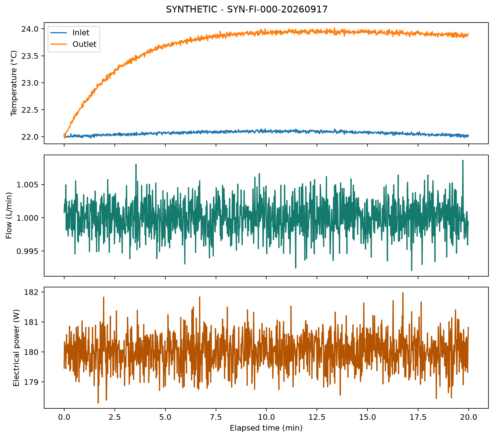
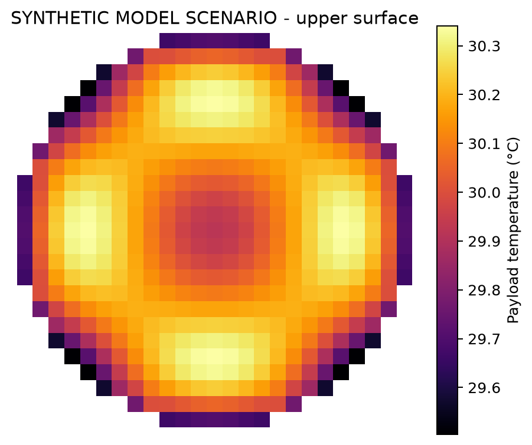

# Demo run

The demo makes five synthetic runs, and four pass while one is rejected on purpose. None of the numbers are experimental results. Back to the [README](../README.md).

> [!NOTE]
> synthetic: generated by the code, not measured · steady-state check: test that flow, temperatures and power held steady long enough · imposed h: coolant-side heat-transfer coefficient set by hand, not predicted · IR: infrared camera temperature data · CFD: computational fluid dynamics, a full flow simulation

## What the demo does

`coldplate demo --config configs/demo.json --output outputs/demo` makes the five synthetic runs. The settings come from `configs/demo.json`, which also holds the model assumptions and the provisional acceptance criteria.

The five runs are there to check the code. They don't rank the inserts, and they say nothing about how a real insert behaves. Git ignores the generated output, so use a fresh output folder when you change the inputs.

## What was checked

The software verification run completed the installed `coldplate demo` command with 4 accepted synthetic runs and 1 rejected run. That confirms the workflow runs end to end, and it doesn't validate the physical apparatus. See [Verification](verification.md) for the environment and the tests.

## The figures

These are synthetic logger data, not measured from real hardware. They only show the calibrated channels and how the analysis works.

This is a model-only temperature scenario with an imposed coolant-side `h`. It isn't an IR measurement, a CFD result or a prediction for any insert.

## What it doesn't show

Please don't present the synthetic examples as measurements. The thermal calculation imposes sensitivity patterns for `h`. It doesn't predict `h` from the insert geometry or the flow, it doesn't model the coolant warming up, and it can't rank the inserts.

Sources: configs/demo.json, src/coldplatetwin/, docs/verification.md, docs/figures/synthetic_time_traces.png, docs/figures/synthetic_thermal_map.png
