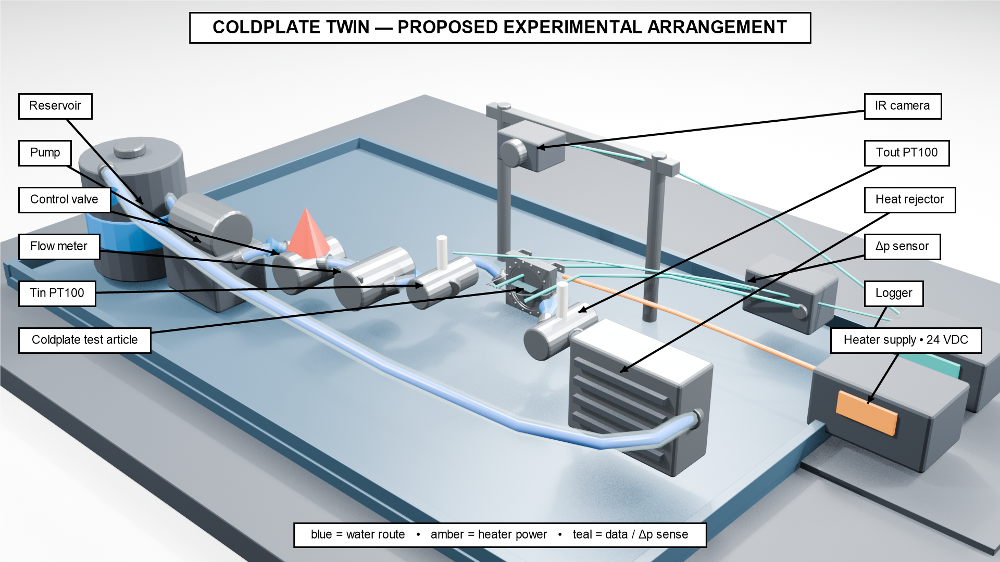

# Experiment visualization

The scene depicts the proposed ColdPlateTwin apparatus. The cold plate is imported from the Rev A assembly; the camera, pump, reservoir, plumbing, instruments, stand and electrical connections are schematic. Their appearance, scale and routing are illustrative, not construction or wiring instructions. No thermal or hydraulic result is encoded in the render.



## Files

- `ColdPlateTwin_experiment.blend`: editable scene supplied with the final render package.
- `build_scene.py`: procedural scene builder with equipment positions, paths and colors near the top.
- `blender_mesh/coldplate_assembly_meters.obj`: 51 named parts in assembly coordinates, in **metres**. Import at scale 1.0; the CP-001 base is 0.200 m wide.
- `blender_mesh/mesh_manifest.json`: source labels, original millimetre bounds and tessellation information.
- `annotate_overview.ps1`: Windows PowerShell label overlay for the final 1920×1080 overview.
- [Overview](../docs/figures/experiment_overview.png) and [close-up](../docs/figures/coldplate_closeup.png): supplied final PNGs.

The metre-scaled OBJ is for visualization. STEP and FreeCAD remain the engineering geometry. The OBJ has 184,994 triangles; its object count, face indices and aggregate dimensions were checked when exported from FreeCAD.

## Regeneration

The supplied images were produced with Blender 5.2.1 LTS and EEVEE, according to the render package's build record. With Blender on your command path, run from the repository root:

```sh
blender --background --python visualization/build_scene.py -- --preview
blender --background --python visualization/build_scene.py -- --final
```

The first command produces a 960×540 preview. The final command creates 1920×1080 views and saves the scene under `visualization/render_output/`. The final overview is initially saved as `experiment_overview_clean.png`; it receives print labels in a separate Windows step:

```powershell
& .\visualization\annotate_overview.ps1
```

If Blender is not on PATH, invoke its installed executable instead. The overlay uses Windows `System.Drawing` and Arial. The already-labeled image is committed so viewing this repository does not require PowerShell or Blender.

Final PNGs and the scene were imported from the supplied render package. Packaging removed a workstation-specific fallback path from the scene builder; it did not rerender or alter the supplied images. Inspect any regenerated output before replacing the published figures.
